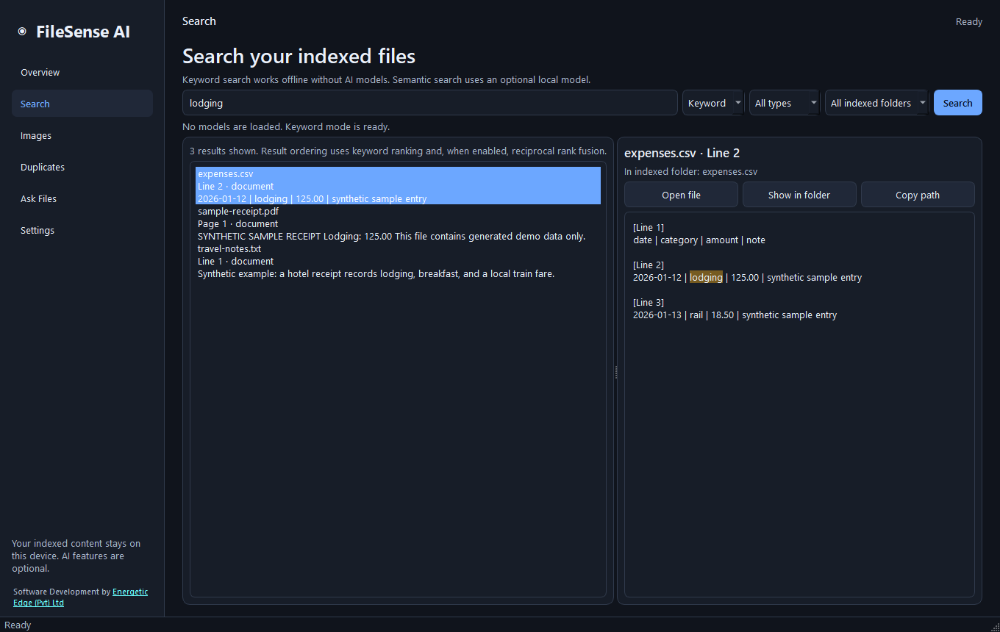
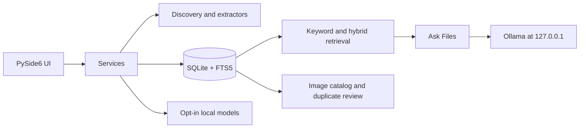

# FileSense AI

**Find files by meaning, not just by filename.** FileSense AI is a Windows-first, local desktop search tool. It indexes only folders you select and keeps file content, metadata, search indexes, thumbnails, and optional model weights on your device.

> Keyword search works without AI models or an account. Text embeddings, CLIP image search, and Ollama chat are separate opt-in features. No indexed content is uploaded by FileSense AI.



## Features

| Capability | Status |
|---|---|
| Native PySide6 desktop UI, dark/light themes, keyboard shortcuts | Implemented |
| Safe recursive folder indexing, incremental scans, cancellation | Implemented |
| PDF, DOCX, TXT, Markdown, CSV, LOG extraction; optional XLSX | Implemented |
| SQLite metadata, FTS5 keyword retrieval, local previews and citations | Implemented |
| Optional local MiniLM semantic text search and hybrid ranking | Opt-in; downloads weights after user action |
| Local image catalog, thumbnails, metadata filters | Implemented |
| OpenCLIP text-to-image search | Opt-in; matching CLIP text/image encoders |
| SHA-256 duplicate review and perceptual near-image suggestions | Implemented; review only |
| Grounded chat through local Ollama loopback | Optional; Ollama/model must be installed separately |
| OCR for scanned PDFs | Not included |

## Quick start on Windows

Python 3.12 x64 is the recommended source runtime. Python 3.13 is allowed by the package metadata and is used for local verification when available. Windows 10/11 x64 is the primary target.

```powershell
git clone https://github.com/kasunmalith/filesense-ai.git
cd filesense-ai
py -3.12 -m venv .venv
.\.venv\Scripts\Activate.ps1
python -m pip install --upgrade pip
python -m pip install -e ".[dev,spreadsheet,duplicates,chat]"
python -m filesense_ai
```

Alternatively, run `scripts\bootstrap_windows.ps1`. To install the extras for optional local text/image AI, use:

```powershell
python -m pip install -e ".[semantic,image-ai,spreadsheet,duplicates,chat]"
```

Start with a small sample folder. Use **Overview → Add folder → Index selected folder**. Indexing is manual by default. Keyword search is available immediately.

## Optional model setup

The app does not download model weights on first launch. In Settings, explicitly start the text model action to download and index `sentence-transformers/all-MiniLM-L6-v2` (Apache-2.0 model card). Its semantic quality is English-focused; Sinhala and Tamil semantic quality is not promised. The optional image model action downloads the OpenCLIP ViT-B-32 checkpoint `laion/CLIP-ViT-B-32-laion2B-s34B-b79K` (the model card currently lists 2.42 GB and MIT) and indexes image vectors in the same CLIP space used for text queries. See [model cards](https://huggingface.co/sentence-transformers/all-MiniLM-L6-v2) and [OpenCLIP checkpoint terms](https://huggingface.co/laion/CLIP-ViT-B-32-laion2B-s34B-b79K). Review current model terms before enabling; model weights are not covered by this project's MIT license.

After weights are downloaded, inference runs locally. CPU works; larger collections can take time. Ask Files uses an already-running Ollama service only at `http://127.0.0.1:11434` and sends retrieved excerpts to that local endpoint. It never uses a hosted model endpoint.

## Privacy and safety

- The app scans only selected folder roots. It does not silently crawl disks or follow symlinks.
- It never alters or deletes indexed source files. Duplicate management is review-only.
- Extracted text, metadata, SQLite FTS, thumbnails, and settings live under the per-user app data directory (or `FILESENSE_DATA_DIR` for testing/portable use).
- Model downloads require an explicit action. No telemetry or remote content/image analysis is included.
- File content is treated as untrusted. Preview uses plain text; macros and embedded code are not run.

## Keyboard shortcuts

| Shortcut | Action |
|---|---|
| Ctrl+K | Open Search and focus the query field |
| Ctrl+O | Choose a folder to index |
| Esc | Request scan cancellation or clear the focused search |

## Tests and checks

```powershell
$env:QT_QPA_PLATFORM = "offscreen"
python -m pytest
python -m ruff check .
python -m ruff format --check .
python -m compileall -q src tests
python -m filesense_ai --smoke
```

Tests use generated documents and images. Normal tests do not download model weights or require Ollama. See [docs/TESTING.md](docs/TESTING.md) for actual verification and optional checks.

## Windows executable

The onedir executable is built with PyInstaller. The optional AI extras make the app bundle much larger; model weights and user data remain outside the executable.

```powershell
scripts\build_windows.ps1
```

The build script installs optional model packages and creates `dist\FileSenseAI\FileSenseAI.exe`. For a smaller keyword-only build, edit the install command in the script to omit `semantic` and `image-ai`; those optional features then require a source installation with those extras. A GitHub Actions Windows build workflow is included. No executable is code signed.

## Architecture



See [docs/ARCHITECTURE.md](docs/ARCHITECTURE.md), [docs/LIMITATIONS.md](docs/LIMITATIONS.md), [SECURITY.md](SECURITY.md), and [docs/DECISIONS.md](docs/DECISIONS.md).

Development and verification records: [PROGRESS.md](PROGRESS.md), [docs/IMPLEMENTATION_STATUS.md](docs/IMPLEMENTATION_STATUS.md), and [FINAL_DELIVERY_REPORT.md](FINAL_DELIVERY_REPORT.md).

## Repository map

```text
src/filesense_ai/      application, storage, indexing, search, UI
tests/                 synthetic unit, integration and GUI tests
scripts/               Windows bootstrap/build and synthetic demo-data creator
assets/                original vector app icon
docs/                  architecture, testing, decisions, status and limitations
.github/workflows/     Windows CI and executable build
```

## License

Original FileSense AI code is MIT licensed. Third-party libraries and model weights retain their own licenses and terms. See [LICENSE](LICENSE) and [THIRD_PARTY_NOTICES.md](THIRD_PARTY_NOTICES.md).

## Portfolio summary

> FileSense AI is a native Python desktop application for private, local-first file discovery. It combines incremental SQLite/FTS5 indexing, optional MiniLM semantic retrieval, matching-space OpenCLIP image search, safe duplicate review, and optional loopback Ollama chat. Core keyword search stays usable without an account or AI model.

Public repository: [github.com/kasunmalith/filesense-ai](https://github.com/kasunmalith/filesense-ai). Review the repository metadata and workflow status when preparing releases.
