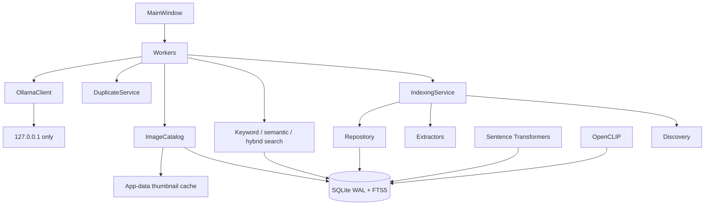

# Architecture

FileSense AI keeps Qt views separate from indexing, database, search, image, duplicate, and chat services. The UI talks to services through background `QThread` workers. Workers open their own SQLite connection; the view layer performs only bounded read operations for previews and counts. Model libraries are imported lazily inside opt-in worker paths.

SQLite is the source of truth for indexed metadata, extracted segments, chunks, and optional vectors. FTS rows are updated in the same transaction as chunk changes. Semantic vectors are packed float32 blobs tagged with a model identifier and compared with a bounded in-process scan; FAISS was not included because this Windows/Python target was not verified against a compatible wheel. The scan is intentionally simple for moderate local libraries; see limitations.

Roots are explicit database records. Discovery skips symlinks, known build/cache folders, oversized files, and the app's own data folder when it is nested beneath a selected root. Stale records are removed only after a complete walk. Each file replacement updates its metadata, extracted segments, chunks, and FTS rows transactionally.

Runtime app data uses `QStandardPaths.AppDataLocation`; tests and portable setups can pass an explicit path or set `FILESENSE_DATA_DIR`. The application never writes to an indexed source folder.
